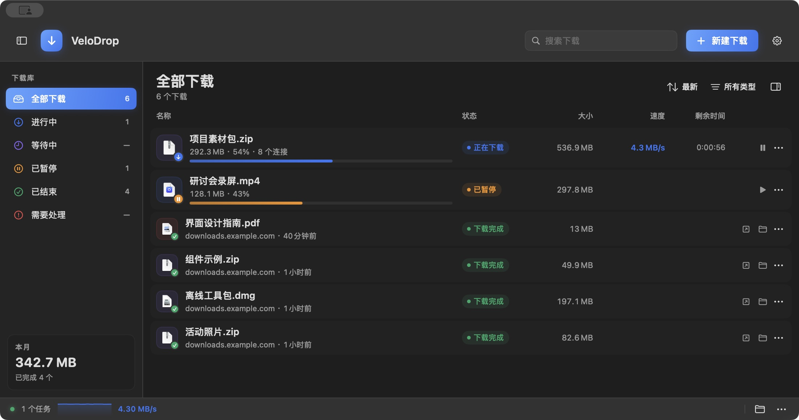
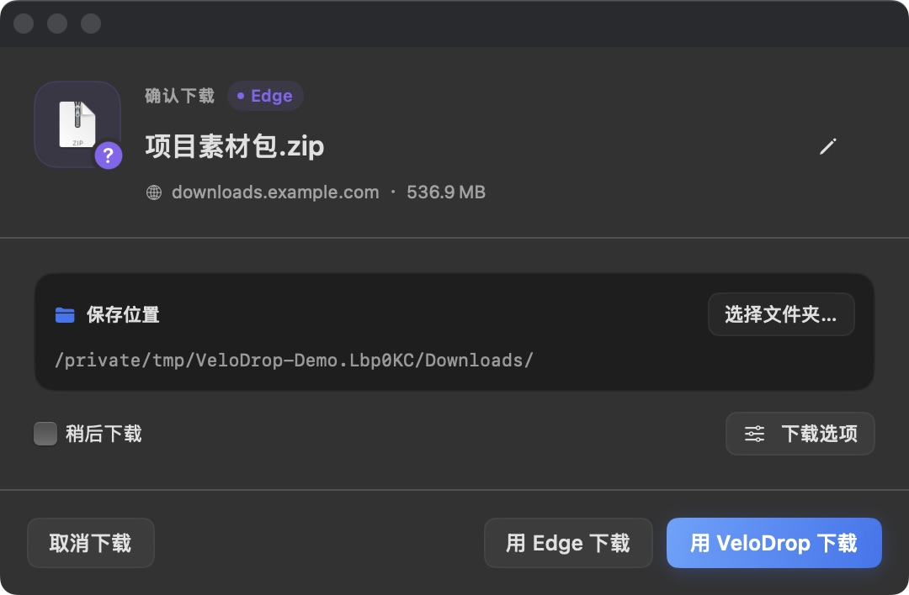
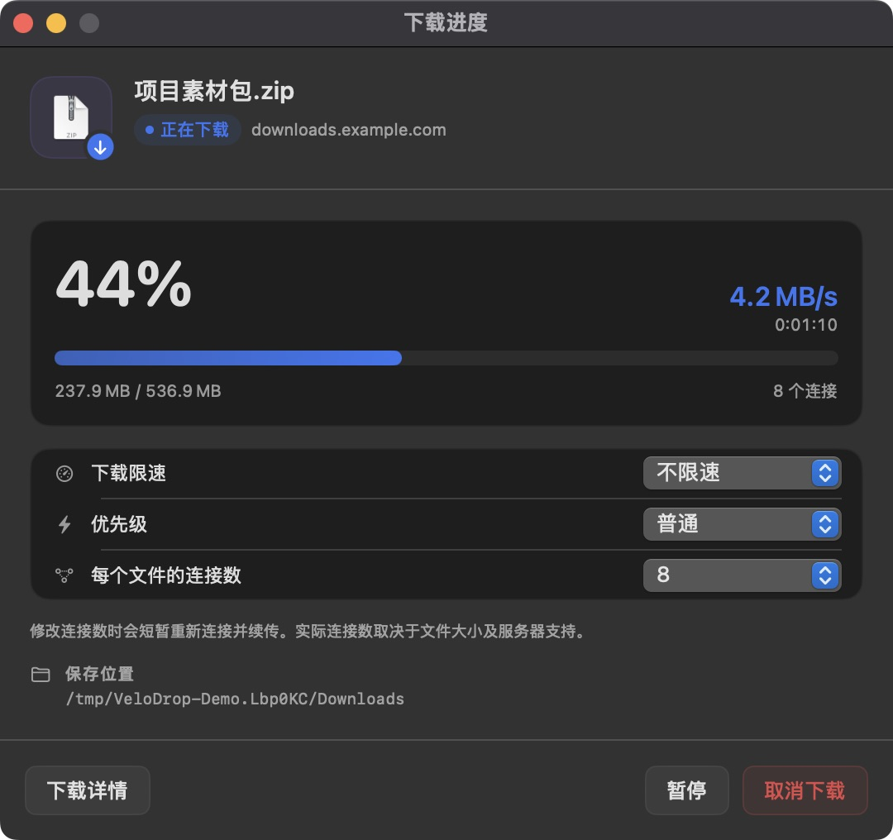

<h1 align="center">VeloDrop</h1>

<p align="center"><strong>原生 macOS 下载管理器</strong></p>

<p align="center">接管浏览器下载，在一个窗口里追踪大文件进度、暂停续传和整理历史记录。</p>

<p align="center">
  <a href="https://github.com/Amayakite/velodrop/releases"><strong>下载 DMG</strong></a>
  · <a href="#快速开始">快速开始</a>
  · <a href="#终端命令">终端命令</a>
</p>

<p align="center"><sub>Apple 芯片 · macOS 14 或更新版本 · 简体中文 / English</sub></p>



## 能做什么

- **接管浏览器下载。** 在 Chrome、Edge、Brave、Vivaldi 或 Firefox 中点下载，把文件交给 VeloDrop。常用站点也可以按规则继续使用浏览器下载。
- **管理大文件和批量链接。** 一次添加多个 HTTP(S) 链接，为单个文件设置连接数、限速和优先级。下载可以暂停，服务器支持时可以续传。
- **整理下载记录。** 按状态或文件类型筛选，搜索、排序、多选，也可以在访达中定位文件。批量删除时可选择只清理记录，或将文件一起移到废纸篓。
- **从终端提交任务。** 0.9.0 起可用 `velodrop` 或 `vd` 直接开始下载，也支持等待结果的后台模式。

## 快速开始

1. 从 [GitHub Releases](https://github.com/Amayakite/velodrop/releases) 下载 DMG，打开后双击「Install VeloDrop」。安装器会把 VeloDrop 放进「应用程序」并打开，升级时会自动替换旧版。
2. 点「新建下载」，粘贴一个或多个链接，每行一个。也可以把链接拖入窗口。关闭窗口后，可从菜单栏的下载箭头或 Dock 再打开。
3. 想接管浏览器下载，在「设置 → 浏览器」选择常用浏览器，点击「连接」。扩展载入后点「测试下载」验证连接。

<details>
<summary>浏览器扩展安装步骤</summary>

**Chrome、Edge、Brave、Vivaldi**

1. 在 VeloDrop 中点击「复制路径并打开浏览器」。
2. 在扩展页面开启「开发者模式」，点击「加载解压缩的扩展」。选择文件夹时按 **⇧⌘G**，粘贴路径并回车，再点「选择文件夹」。
3. 若列表里已有 VeloDrop，可点击扩展的「重新加载」。同时安装了其他下载接管扩展时，可先暂停它们再测试。

**Firefox**

1. 如果安装包附带已签名扩展，可在设置里点「打开已签名的扩展」。
2. 临时载入时，进入 `about:debugging`，点击「临时载入附加组件」。按 **⇧⌘G** 粘贴路径并选择 `manifest.json`。Firefox 重启后需要重新载入临时扩展。

「测试下载」使用本机测试文件，应用会清理测试结果，并在设置中显示是否通过。应用和扩展分别跟随 macOS 和浏览器的界面语言。

</details>

GitHub 安装包采用 ad-hoc 签名，尚未经过 Apple 公证。也可以[在本机从源码构建](#从源码构建)。

## 下载流程

<table>
  <tr>
    <th width="50%">接管前确认</th>
    <th width="50%">下载中查看进度</th>
  </tr>
  <tr>
    <td valign="top">
      <p>确认来源和保存位置，按需改文件名、稍后下载，或交还给原浏览器。</p>
      <a href="docs/images/browser-confirmation.jpg"></a>
    </td>
    <td valign="top">
      <p>查看进度、速度和实际连接数，随时调整限速、优先级或每个文件的连接数。</p>
      <a href="docs/images/download-progress.jpg"></a>
    </td>
  </tr>
</table>

## 终端命令

终端命令从 **0.9.0** 起提供。可以[从源码构建](#从源码构建)，或在 [GitHub Actions](https://github.com/Amayakite/velodrop/actions/workflows/ci.yml) 的 `main` 成功构建中，从 Artifacts 下载对应版本的 DMG。

在「设置 → 通用 → 终端」点「安装终端命令」。勾选「同时安装短命令 vd」即可使用 `vd`。如果终端找不到命令，把 `export PATH="$HOME/.local/bin:$PATH"` 加入 shell 的启动文件（如 `~/.zshrc`），再打开新的终端。

```sh
velodrop 'https://example.com/file.zip'
vd --connections 12 --dir './packages' 'https://example.com/a.zip' 'https://example.com/b.zip'
velodrop --no-ui --wait 'https://example.com/file.zip'
```

命令会直接把链接提交给 VeloDrop，打开下载窗口并选中新任务。省略 `--connections` 或 `--dir` 会使用应用设置。`--dir` 的相对路径以终端当前目录为准。同名文件会保留两份。

`--no-ui` 在后台提交。`--wait` 等待整批下载结束，全部成功时退出码为 `0`，有任务失败、取消或提交失败时为 `1`，参数错误时为 `2`。命令向标准输出逐行写入任务 ID。按 Ctrl+C 可以结束终端等待，已提交的任务继续在应用中运行。

## 进阶使用

<details>
<summary>浏览器规则、续传和下载记录</summary>

- 默认接管已知大小至少 2 MiB 的普通文件。在「设置 → 浏览器」可调整接管开关、大小门槛和排除站点。排除规则同时检查下载地址、重定向后的地址和来源页。
- 默认开启「下载前弹窗确认」。普通可重试的下载在浏览器确定文件名时接管。部分特殊链接会在交接时保留原任务，浏览器可能仍显示下载菜单。
- 可设置 1–16 路连接，默认 8 路，同时下载任务数可设为 1–10。续传取决于服务器对字节范围的支持。调整连接数时会短暂重连。
- 默认沿用浏览器的 User-Agent 和可识别的代理。可在设置中开启「沿用浏览器会话请求头」。固定 HTTP 代理和直连可交给 VeloDrop，PAC、SOCKS、识别出的非 GET 请求及无法可靠沿用的网络环境留给浏览器。
- 浏览器会话头只用于原接管请求。详情保存头名称，来源链接去掉查询参数和片段。双击任务可查看时间、来源、保存位置和代理。
- 同名文件可选择保留两份、跳过或替换。删除进行中的任务会先停止下载，文件会移到 macOS 废纸篓。

</details>

[隐私政策 / Privacy Policy](docs/PRIVACY.md)

## 从源码构建

[](https://github.com/Amayakite/velodrop/actions/workflows/ci.yml)

需要 macOS 14 或更新版本、Swift 6 和 Apple Command Line Tools。GitHub 目前提供 arm64 安装包。构建脚本为执行构建的 Mac 架构生成安装包。

```sh
Scripts/package.sh
swift run -c release VeloCoreChecks
node Scripts/cli-smoke.mjs
bash Scripts/browser-checks.sh
```

安装包位于 `.dist/`。设置 `VELODROP_SIGN_IDENTITY` 可用自己的 Developer ID 签名。端到端测试需要 Chrome、Edge、Firefox、geckodriver 和 Node.js 22 或更新版本。测试使用独立浏览器配置、临时连接器和本机 HTTP 测试服务。请在测试前退出同一套打包产物。

### 自动构建与发布

- push 和 pull request 会运行 Release 构建、核心检查、本地化和脚本校验、打包、终端命令及三款浏览器的回归测试。见 [CI](.github/workflows/ci.yml)。
- main 分支的 CI 会额外产出一个可用 Actions artifact 下载的未发布 DMG。
- 推送 `v*` tag 会触发 [Release](.github/workflows/release.yml)：在 arm64 `macos-15` runner 上重新打包、验证 DMG 与签名、生成 SHA256，并自动创建 GitHub Release。
- 版本号唯一来源是 `Extension/manifest.json`，发布 tag 必须与它一致。完整步骤、手动重跑、签名与常见问题见 [docs/RELEASING.md](docs/RELEASING.md)，版本记录见 [CHANGELOG.md](CHANGELOG.md)。

## 实现

- **Mac 界面**使用 SwiftUI 内容和 AppKit 标准窗口，所有窗口在屏幕可见区域居中显示；菜单栏通过 `NSStatusItem` 打开下载窗口。空闲时靠目录事件接收任务，下载引擎退出，扩展也停止周期检查。
- **下载**使用随包编译的 aria2 1.37.0，并行 HTTP(S) 分段和续传元数据由 aria2 维护。下载时仅通过有随机口令的本机回环接口与 aria2 通信。
- **安装与升级**由 DMG 内的轻量安装器完成：它退出正在运行的旧版本、原位替换应用并重新打开；应用内菜单和设置也可以检查更新，把 DMG 交给同一个安装器处理。规则和设置都保存在应用中，升级不会丢失。
- **浏览器交接**通过 MV3 扩展和一次性 Swift Native Messaging helper。扩展不保存接管设置，而是通过 helper 读取应用维护的 `browser-rules.json`。针对可重新请求的下载，连接器先登记任务，再在浏览器取消原任务后启动已登记的下载。文件写入临时目录，校验已知文件大小并添加 macOS 隔离属性后才保存到下载目录。
- **后续扩展**可在独立下载引擎层加入 BT 和磁力链接。

aria2 以独立程序随应用分发，安装包内含上游许可证、对应源码归档、限制浏览器请求头作用范围的补丁和构建脚本。界面和交接流程参考了原生菜单栏工具以及成熟下载器的做法，例如 [Apple MenuBarExtra](https://developer.apple.com/documentation/swiftui/menubarextra)、[Haul](https://haul.sibiraj.dev/) 和 [Convoy](https://github.com/TheDynamicPunk/Convoy)。
